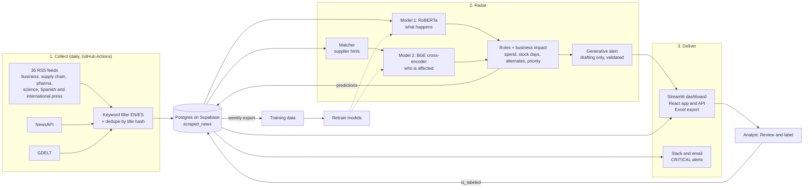

# Supplier Risk Radar

**Always-on news monitoring for pharmaceutical supply chains.** The platform collects news every day from the press, stores it in a database, decides which articles are a risk for any of the client's 40 suppliers, turns them into business impact (euros at risk, stock days, alternates), drafts the alert, notifies the team and learns from the analyst's corrections.

Winning project of Challenge 4 at **Accenture GenAI Mavericks** (Madrid, October 2026), for the fictional client *Helixa Pharmaceuticals*.

It has two parts that work together:

| Part | What it does |
|---|---|
| **Monitoring platform** | Scrapes news on a schedule, deduplicates and stores them in Postgres (Supabase), classifies new articles, sends Slack/email alerts, and feeds analyst corrections back into training. |
| **Radar (the models)** | For each article answers: is it a risk (`Is_Risk`), is it urgent (`Urgent`), and which of the 40 suppliers are affected (`Affected_Supplier_IDs`). Then adds business impact and a drafted alert. |

## The big picture



## 1. Monitoring platform

**Collection** (`scraper.py`). Three kinds of sources: 36 RSS feeds (international business and world news, supply chain and pharma trade press, science journals, and Spanish media such as El País, El Mundo, Expansión, ABC, RTVE and EFE), the NewsAPI and the GDELT DOC API. Only articles that match a keyword filter in English or Spanish (supply chain, shortage, recall, strike, flood, port, tariff, cold chain, ...) are kept, and duplicates are dropped by a hash of the title.

**Storage** (Supabase, Postgres through its REST API). Every article lands in the table `scraped_news` with its source, publication date, scrape time, the model's predictions (risk and urgency probabilities, event type, predicted suppliers, confidence) and the human label when an analyst has reviewed it. The tables are created by `supabase_schema.sql`.

**Automation** (`.github/workflows/`):

- *Daily at 06:00 UTC (08:00 in Spain during summer time):* scrape, classify the new articles, and send notifications for critical alerts.
- *Weekly (Mondays):* export the labelled data for retraining.

**Notifications** (`notify.py`). Critical alerts from the last 24 hours go out to Slack (webhook) and/or email (SMTP).

## 2. Radar: how an article is analysed

1. **Matcher** (`radar/matcher.py`). Plain rules, no ML. For each supplier it looks for the name (full, partial or look-alike), city, region, country and material in the article and leaves weighted hints. It decides nothing on its own.
2. **Text model** (`train_text.py`, `radar/nn.py`). `roberta-base` (125M parameters, encoder-only, BERT family) fine-tuned by us. It reads the whole article with self-attention, mean-pools the token vectors and feeds five heads: risk, urgency, event type (16 classes), supply impact and duration.
3. **Link model** (`train_link.py`). `BAAI/bge-reranker-base`, a cross-encoder fine-tuned by us. News, supplier profile and matcher hints go in one sequence, so every word of the news can attend to every word of the profile. It returns a relation score, and we score all 40 suppliers for each article.
4. **Decision rules** (`radar/analyze.py`). No linked supplier means no risk; positive news is never a risk; urgent means risk plus a high urgency probability (the urgency head combined with the probability of a stoppage).
5. **Business impact layer** (`radar/impact.py`). Deterministic joins with the client's supplier and material tables: annual spend, inventory cover days, single-source flag, approved alternate and products using the material. Duration is extracted from the text ("two weeks" becomes 14 days) and compared with inventory cover. Priority: `CRITICAL` (urgent and single source or stock shortfall), `HIGH` (urgent), `MEDIUM` (high criticality or single source), `LOW`.
6. **Alert drafting** (`radar/alerts.py`). A local LLM through Ollama writes title, summary, why it matters, next steps and a draft email to the supplier. The output is checked against invented IDs and numbers, with a template fallback.

### Why own models decide and generative AI only writes

An LLM prompted directly with the news and the supplier table is easy to build, but in our tests it was unpredictable, slow, hard to measure and **it invented supplier IDs that do not exist**. We kept the decisions for models we fine-tuned ourselves, and limited generative AI to a role where mistakes can be caught: if its text mentions an ID or a figure that is not in the facts, the draft is discarded and a template is used.

| | Own fine-tuned models (chosen) | Prompting an LLM |
|---|---|---|
| Consistency | Same news, same answer; measurable accuracy | Less predictable, harder to measure |
| Learning | Retrained with the client's data and analyst feedback | A prompt does not learn |
| Speed | Seconds per batch | Unpredictable latency |
| Cost | No cost per article | One call per article |
| Supplier IDs | Can only score the 40 real suppliers | Invented IDs that do not exist |

## 3. What the user sees

- **Streamlit dashboard** (`dashboard.py`, English and Spanish) with seven tabs: *Alerts*, *Actions*, *Map*, *KPIs*, *Live news alerts* (the scraped articles from the database), *Weather alerts* (72-hour Open-Meteo forecast for the supplier cities) and *Review and label*.
- **React app + FastAPI** (`frontend/`, `api.py`): suppliers, alerts, KPIs, alternatives and Excel export.
- **Excel** (`run.py`): a `Results` sheet with the four required columns (`News_ID`, `Is_Risk`, `Urgent`, `Affected_Supplier_IDs`) and a `Details` sheet with impact and reasoning.

## 4. The learning loop

The *Review and label* tab shows the articles the model is least sure about (confidence between 0.15 and 0.70) and lets the analyst confirm or correct them. Labels are saved in the database (`is_labeled`). `export_training.py` merges them into `data/supabase_train.csv`, which is part of the training data for the next retraining. A standalone labelling UI is also available (`labeler.py`).

## Data and evaluation

The client portfolio has 40 suppliers with 62.5 M EUR of annual spend; 14 of them are single source (28.2 M EUR, 45% of spend).

Training data (about 4,500 examples in the final run):

- the 30 labelled articles from the challenge training workbook,
- synthetic articles from templates (`radar/synth.py`) with labels by construction, including traps: look-alike supplier names, places without an event, positive news,
- generic business news as negatives,
- articles scraped into Supabase and labelled by rules,
- about 200 labels distilled once with Claude Haiku (`distill_claude.py`).

**How we measured honestly.** The synthetic templates were written while looking at the training and validation sets, so validation is no longer a clean measure. The clean measure is an independent holdout of 30 articles written by the team (`data/Supplier_Risk_Holdout.xlsx`), never used for training. The challenge's Test set has no labels and was not used for training or tuning. After training, reproduce it with:

```bash
python3 evaluate.py --data holdout
```

## Quick start

Everything lives in `supplier-radar/`.

```bash
cd supplier-radar
python -m venv .venv
source .venv/bin/activate            # Windows: .venv\Scripts\activate
pip install -r requirements.txt
```

**A. Analyse news without training (rules baseline).** Works immediately, no model weights needed. It is much less accurate than the models:

```bash
python3 run.py data/Supplier_Risk_3_Test.xlsx --mode rules
```

**B. Train the models.** Weights are not in git (size). The training data is already in `data/`. The script downloads `roberta-base` and `bge-reranker-base` from Hugging Face, trains both, calibrates thresholds and runs the holdout. A GPU is strongly recommended:

```bash
bash train_all_local.sh
```

For the full 3-seed ensemble see [`supplier-radar/README.md`](supplier-radar/README.md).

**C. Analyse news with the trained models:**

```bash
python3 run.py data/Supplier_Risk_3_Test.xlsx            # -> out/Supplier_Risk_3_Test_result.xlsx
python3 inspect_run.py data/Supplier_Risk_3_Test.xlsx     # readable report
```

Any Excel with the same columns as the Test file works.

**D. Dashboard.** In the sidebar choose *Models* or *Rules* as the engine:

```bash
streamlit run dashboard.py
```

**E. API and React app:**

```bash
uvicorn api:app --port 8000
cd frontend && npm install && npm run dev      # http://localhost:5173
```

**F. Turn on the monitoring platform (Supabase).**

1. Create a free Supabase project and run `supabase_schema.sql` in its SQL editor.
2. Copy `.env.example` to `.env` and fill in `SUPABASE_URL` and `SUPABASE_KEY` (plus `NEWSAPI_KEY`, and Slack/SMTP values if you want notifications).
3. Run the loop by hand:

```bash
python3 scraper.py --source all                      # collect -> database
python3 classify_supabase.py --mode models --unlabeled   # classify new articles
python3 notify.py                                    # Slack / email for CRITICAL alerts
```

4. To automate it, add the same values as repository secrets (`SUPABASE_URL`, `SUPABASE_KEY`, `NEWSAPI_KEY`, `SLACK_WEBHOOK_URL`, `ALERT_EMAIL`, `SMTP_*`) and the workflows in `.github/workflows/` take over.

The *Live news alerts* and *Review and label* tabs of the dashboard read from this database, so they stay empty until step 3 has run at least once.

**G. Alert drafting with a local LLM (optional).** Install [Ollama](https://ollama.com), pull any model, and tick *Draft alerts with generative AI* in the dashboard. Without Ollama the alerts use templates.

## Repository layout

```
supplier-radar/
  radar/              core library: matcher, models, rules, impact, alerts, pipeline
  scraper.py          news collection (RSS, NewsAPI, GDELT) -> Supabase
  classify_supabase.py  classifies stored articles
  notify.py           Slack and email alerts
  export_training.py  human labels -> training data
  train_text.py, train_link.py   fine-tune the two models
  calibrate.py, evaluate.py      thresholds and accuracy
  run.py              Excel in, Excel out
  dashboard.py, labeler.py       Streamlit apps
  api.py, frontend/   FastAPI backend and React frontend
  supabase_schema.sql database tables
  augment.py, gen_*.py, fetch_*.py, distill_claude.py   training-data tools
  data/               challenge workbooks, holdout, synthetic and scraped training data
  docs/               hand-off guide written during the hackathon (Spanish)
.github/workflows/    daily scraping and weekly export
```

## Known limitations

- **Model weights are not included.** They have to be trained (see Quick start B).
- **The scheduled GitHub Action classifies with the rules baseline**, not the trained models, because the weights are not available in CI. Run `classify_supabase.py --mode models` where the weights are to get model predictions.
- **Calibrated thresholds are not applied yet.** `calibrate.py` writes `models/thresholds.json`, but inference currently uses 0.5 for all decisions (`models_result` in `radar/analyze.py` does not pass `models.thr` to `finalize_models`).
- **GeoNames regions are not wired in.** `fetch_geo.py` generates `data/geo_regions.json`, but `radar/knowledge.py` currently relies on its built-in alias lists.
- **Duration and supply-impact predictions** from the models are not written to the Excel details; the impact layer extracts the duration from the article text instead.
- **`distill_claude.py` uses an external API.** It was run once to create labels and sends the supplier table to Anthropic's API; everything else runs locally.
- The hand-off guide in `supplier-radar/docs/` was written mid-hackathon and some commands refer to the original GPU server setup.

## Team

Lucía Gómez Jiménez, Bertrán Vidal Campos, José Miguel Serrano, Alejandro Gómez Ares and Ángela Martínez.

## Team

Lucía Gómez Jiménez, Bertrán Vidal Campos, José Miguel Serrano, Alejandro Gómez Ares and Ángela Martínez.

## Data

The challenge data files provided by Accenture are not included in this repository.
